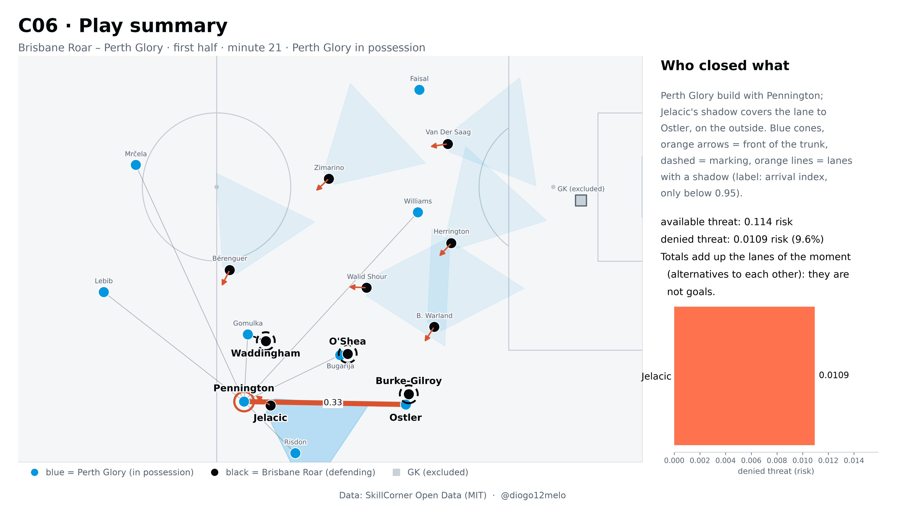

# Cover Shadow Value

A defender who is not touching the ball can still take passes away. Cover Shadow Value measures it: the
cone behind a defender's trunk (taken from body pose, not from the ball) closes the passing lanes that cross it,
and closing a lane has value even without a tackle or an interception. This repository computes the metric on
the SkillCorner open data (A-League 2024/25: tracking, events and body pose) and reproduces the numbers and
figures of the article.



Article: [English](paper/Cover_Shadow_Value_EN.pdf) · [Português](paper/Cover_Shadow_Value_PT.pdf)

## Requirements

- Python 3.12 and [uv](https://docs.astral.sh/uv/)
- About 3 GB of disk for the two games with body pose, plus the tracking of eighteen more games if you
  want the pass-model calibration (see below)
- About 1 GB more for the intermediate tables (`data/interim/`, `data/processed/`) and the outputs of the full path
- Memory: 16 GB of RAM is recommended for the full path. The parallel scripts (`avaliar_variantes.py`,
  `avaliar_variantes_v4.py`) take `--trabalhadores N` and each worker needs 1 to 2 GB. With 6 workers on a 16 GB laptop
  (about 5 GB free) the run stopped with `numpy._core._exceptions._ArrayMemoryError`; with 1 to 3 workers it ran to the
  end. Use 3 workers with 8 GB or more free and 1 worker with less. `calibracao_fundo.py calibrar` (`--processos`,
  6 by default) needs about 0.3 GB per process
- Windows, macOS or Linux (developed on Windows)

## Install

```
uv sync
uv run pytest -q          # unit tests; no data needed
```

## Data (not included)

All data come from SkillCorner Open Data (MIT licence) and are downloaded on demand into `data/raw/`, which is
git-ignored:

- tracking (10 fps), dynamic events and phases of play: <https://github.com/SkillCorner/opendata>
- body pose (25 fps), only two games (1925299 and 1996435): <https://huggingface.co/datasets/SkillCorner/opendata-bodypose>

```
uv run python -m footy.ingest.skillcorner --jogo 1925299 --tracking --pose     # about 700 MB
uv run python -m footy.ingest.skillcorner --jogo 1996435 --tracking --pose     # about 700 MB
```

The two games with pose are enough for the metric and for most numbers. The calibration of the pass model
(`xpass.py`, `calibracao_fundo.py`) also uses the other eighteen open games, tracking only:

```
for j in 1874553 1886347 1899585 1927964 1953632 1959846 1986691 1996436 2006229 \
         2006363 2007448 2007721 2010085 2011166 2013725 2015213 2016236 2017461; do
  uv run python -m footy.ingest.skillcorner --jogo $j --tracking
done
```

## Reproduce

Run from the repository root. The scripts are idempotent: what is already computed is not repeated.

### Quick path: the C06 play (about 15 minutes after the download)

```
cd projects/cover_shadow
uv run python preparar_dados.py --jogo 1925299                    # about 2 min per game: aligns tracking and pose
uv run python preparar_dados.py --jogo 1996435
uv run python avaliar_variantes.py --versao v3 --so base bola     # about 2 min per game and variant, in parallel
uv run python avaliar_variantes.py --versao v3_1 --so base bola
uv run python numeros_9c.py                                       # about 3.5 min: loss costs and phase index
uv run python numeros_9d.py --so c06 c03 caso_pressao_alta        # under 1 min
```

This recomputes the C06 play of the article: denied threat 0.0109 (risk currency) out of 0.114 available,
Jelacic at phase index 157. `outputs/cover_shadow/artigo_v31.json` comes out identical to the tracked copy.

### Full path

The order below is the one that ran to the end, from the raw data, with nothing computed beforehand. Run it from
`projects/cover_shadow`; each script's docstring says what it needs and writes, and a script that cannot find
the output of an earlier step stops and tells you which step to run first. Steps 6 and 7 need the eighteen extra
tracking games. Times are rounded and come from the run on a 16 GB Windows laptop (`--trabalhadores 3`).

| # | Command | About |
|---|---|---|
| 1 | `preparar_dados.py --jogo <id>` for both games | 2 min per game |
| 2 | `avaliar_variantes.py --versao v2`, then `--versao v3`, then `--versao v3_1` (`--trabalhadores 3`) | about 30 min per version |
| 3 | `escolha.py`, then `modelo_escolha.py` (who the passer picks, and the conditional-logit model of that choice) | 1 min |
| 4 | `calcular_v4.py --jogo <id>` for both games, then `avaliar_variantes_v4.py`, then `avaliar_variantes_v4.py --fundo` | 5, 41 and 15 min |
| 5 | `calibracao_passe.py`, then `calcular_modelo_passe.py --jogo <id>` for both games | 6 and 6 min |
| 6 | `calibracao_fundo.py preparar`, then `calibracao_fundo.py calibrar` (writes `calibracao_20_jogos.json`) | under 1 min and 187 min (3 h) |
| 7 | `xpass.py preparar`, `calcular_xpass.py --jogo <id>` for both games, `calcular_xpass.py --literatura --jogo <id>` for both games, then `avaliacao_xpass.py` (writes `xpass_v4.json`) | under 1, 6, 6 and 1 min |
| 8 | `reprodutibilidade_v31.py` (recomputes v3.1 from the raw data and checks that the tables match) | 8 min |
| 9 | `numeros_v31.py`, `numeros_9c.py`, `numeros_9d.py`, then `numeros_revisao.py` (all article numbers into `outputs/cover_shadow/artigo_v31.json`) | 2, 3, 7 and about 5 min |
| 10 | Figures: `figuras_artigo.py`, then copy `outputs/cover_shadow/artigo/` to `outputs/cover_shadow/artigo_v31_xt/`, then `figuras_9d.py` (Portuguese, writes `legendas.md`) and `figuras_9e.py` | 2, under 1, 1.5 and 1.5 min |
| 11 | `orientacao_defesas.py` (adds the orientation section to `legendas.md`, so it comes after the figures) | under 1 min |
| 12 | `figuras_10a.py --idioma pt`, `--idioma en`, `--idioma pt --variante escura` and `--idioma en --variante escura` (`--variante clara` is the default) | 1.5 min each |

The whole path takes about 6.5 to 7 hours, 3 of them in step 6. In step 7, `avaliacao_xpass.py` reads the tables
written by `calcular_xpass.py --literatura`, so that command must run before it.
`animar_c06.py` writes the C06 animation (MP4 and one PNG per step); it is not part of the path above.

**Check.** Steps 1 to 9 were run from scratch, from the raw SkillCorner files into empty `data/interim/`, `data/processed/`
and `outputs/` folders, and reproduce the numbers of the article: `artigo_v31.json`, `calibracao_passe.json`,
`calibracao_20_jogos.json`, `xpass_v4.json` and `reprodutibilidade_v31.json` come out equal to the reference copies with a
tolerance of 1e-9 (only the timing fields and the test counts differ). The intermediate tables match on every shared column
(the `*_linhas` tables of this code have one more column than the reference: `comprimento` in v2 and v3, `p_fundo` in v4).
`numeros_revisao.py`, added with the final revision of the article (defenders with their back to the ball carrier, section 6.3, and
the ρ of denied threat per moment, sections 7.3 and 7.4), was run afterwards on tables that match the fresh run of steps 1 to 9; it only
adds the `revisao` section to `artigo_v31.json` and leaves the rest of the file unchanged.
Steps 10 to 12 give 64 figures (16 figures, in Portuguese and English, light and dark theme) identical pixel by pixel to the ones in
`figures/` (maximum difference 0, no pixel different); they were run on tables that match the fresh run of steps 1 to 9 to the same tolerance.

The notebooks in `projects/cover_shadow/notebooks/` tell the same story step by step, with their outputs.

## Where things end up

| What | Where |
|---|---|
| Article numbers (all of them, one file) | `outputs/cover_shadow/artigo_v31.json` (a copy is tracked) |
| Figures of the article, light theme | `figures/pt/`, `figures/en/` |
| Same figures, dark theme (social media) | `figures/social/pt/`, `figures/social/en/` |
| Intermediate tables | `data/interim/`, `data/processed/` (git-ignored) |
| Generated figures and animation | `outputs/cover_shadow/` (git-ignored) |

Figure numbers are those of the article: 1 `agregado_versoes`, 2 `c06_passo4_cones_pelo_tronco`,
3 `c06_passo5_probabilidade_de_o_passe_chegar`, 4 `c06_passo8_resumo`, 5 `agregado_revisoes`,
6 `agregado_fase_e_terco`, 7 `agregado_c3_sombra_escolhida`, 8 `agregado_c5_tronco_vs_bola`,
9 `c06_corpo_vs_bola`, 10 `agregado_c4_estabilidade`, 11 `novo_c8_escolha_do_passe`, 12 `novo_moedas_por_fase`,
13 `novo_pressao_alta_goodwin`, 14 `novo_xpass_calibracao_e_gamma`, 15 `c03_lance`,
16 `orientacao_bola_vs_frente`. Figure 5 summarises the three rounds of play review, the first by the author and
the following two by coaches external to the work; it is generated from `projects/cover_shadow/referencias/revisao_contagens.csv`
(the sheets with the reviewers' comments are not published).

## Structure

```
config/brand.yaml              colours and fonts (light and dark variants)
src/footy/                     the small library the project needs
  ingest/skillcorner.py        download and read the SkillCorner open data
  transform/skillcorner_pose.py  align tracking and body pose in time
  metrics/orientacao.py        trunk orientation from the pose keypoints
  viz/theme.py, viz/goal.py    theme and drawing helpers; video/compose.py writes MP4s
projects/cover_shadow/
  metrica/                     the metric: cones, arrival index, marking, xT, Shapley split
  *.py                         pipeline, evaluation, numbers, figures (PT and EN) and the C06 animation
  notebooks/                   01 to 12, one per CRISP-DM step, with outputs
  tests/                       unit tests
  referencias/open_xt_12x8_v1.json   open 12x8 xT grid used for lane value
  DECISOES.md                  every method decision and why (in Portuguese)
```

Code comments, docstrings and `DECISOES.md` are in Portuguese; figures and captions exist in Portuguese and English.

## Tests

```
uv run pytest -q
```

## Licence and citation

Code: MIT (see `LICENSE`), Diogo Melo, 2026. The data are SkillCorner's (MIT) and are not included; please credit
SkillCorner wherever you use them. To cite this work use `CITATION.cff` (GitHub shows a "Cite this repository" button).

---

## Resumo em português

O Cover Shadow Value mede o valor do posicionamento defensivo sem bola: o cone que sai das costas do tronco de um
defesa (dado pela *body pose*, não pela bola) fecha as linhas de passe que o atravessam, e isso tem valor mesmo sem
desarme nem interceção. Este repositório calcula a métrica com os dados abertos da SkillCorner (A-League 2024/25) e
reproduz os números e as figuras do artigo.

Artigo: [English](paper/Cover_Shadow_Value_EN.pdf) · [Português](paper/Cover_Shadow_Value_PT.pdf)

- **Instalar:** `uv sync` (Python 3.12 e uv). Testes: `uv run pytest -q`.
- **Dados:** não vêm no repositório. Descarregam-se com `uv run python -m footy.ingest.skillcorner --jogo <id> --tracking --pose`
  (jogos 1925299 e 1996435, cerca de 700 MB cada); os outros 18 jogos abertos só com tracking servem para calibrar o modelo do passe.
- **Reproduzir:** a ordem dos comandos está na secção *Reproduce* (cerca de 7 horas no total, 3 só no passo 6; 16 GB de RAM
  recomendados e `--trabalhadores` entre 1 e 3); os números do artigo ficam em `outputs/cover_shadow/artigo_v31.json`.
- **Figuras:** `figures/pt/` e `figures/en/` (tema claro, artigo) e `figures/social/` (tema escuro, redes sociais).
- **Decisões de método:** `projects/cover_shadow/DECISOES.md`. O código e os comentários estão em português.
